# 💗 QUANTUM LOVE COLLIDER
### A Quantum Physics Adventure Game | Interactive Quantum Computing Laboratory | Educational Science Platform

<p align="center">

**Build quantum circuits. Explore superposition. Discover entanglement. Save the collider.**

An interactive, story-driven quantum computing adventure that transforms complex scientific concepts into hands-on experiments, missions, challenges, and laboratory discoveries.

</p>

---

# TABLE OF CONTENTS

| Section | Description |
|---|---|
| 01 | Project Overview |
| 02 | Vision and Product Philosophy |
| 03 | The Problem |
| 04 | The Solution |
| 05 | Core Gameplay |
| 06 | Application Architecture |
| 07 | Quantum Computing Foundations |
| 08 | Quantum Simulation Engine |
| 09 | Quantum Gate System |
| 10 | Circuit Editor |
| 11 | Quantum Experiments |
| 12 | Advanced Quantum Algorithms |
| 13 | Game Mechanics and Progression |
| 14 | Characters and Story Campaign |
| 15 | AI Quantum Tutor |
| 16 | Data Architecture and Mock Data |
| 17 | Persistence and Storage |
| 18 | Testing, Security and Performance |
| 19 | Installation and Development |
| 20 | Roadmap and Future Research |

---

# 01 — PROJECT OVERVIEW

## 1.1 Introduction

Quantum Love Collider is an interactive quantum physics adventure designed to make quantum computing understandable through experimentation, storytelling, and gameplay.

The project combines a browser-based quantum circuit simulator with a narrative-driven laboratory environment.

Instead of presenting quantum mechanics exclusively through equations, lectures, or static diagrams, Quantum Love Collider allows players to interact directly with quantum systems.

Players enter a fictional research facility where an experimental collider has experienced a catastrophic malfunction.

The laboratory team must investigate the anomaly, repair experimental systems, reconstruct quantum circuits, and discover what happened.

Every major gameplay challenge introduces a real scientific concept.

Players learn by:

- Constructing quantum circuits.
- Applying quantum gates.
- Preparing superposition states.
- Exploring quantum interference.
- Investigating entanglement.
- Measuring quantum systems.
- Interpreting probability distributions.
- Completing scientific missions.
- Solving increasingly difficult experiments.

The experience combines education with a playful science-fiction narrative.

## 1.2 Project identity

| Attribute | Description |
|---|---|
| Project | Quantum Love Collider |
| Category | Educational game |
| Domain | Quantum computing and physics |
| Platform | Web application |
| Frontend | React |
| Language | TypeScript |
| Build system | Vite |
| State management | Zustand |
| Animation | Framer Motion |
| Styling | Tailwind CSS |
| Validation | Zod |
| Testing | Vitest |
| Visualization | SVG, CSS and chart components |
| Persistence | Local-first browser storage |
| Development environment | Lovable-compatible React project |

## 1.3 Core proposition

Quantum Love Collider turns quantum computing into an interactive experience.

The central idea is:

**Learn quantum physics by building and experimenting with quantum systems.**

The game is not intended to replace formal quantum mechanics education. Instead, it provides an accessible environment where players can develop intuition through guided experimentation.

## 1.4 Design principles

The application is built around five principles.

1. Scientific accuracy.
2. Interactive learning.
3. Story-driven engagement.
4. Accessible explanations.
5. Reusable technical architecture.

Scientific calculations should originate from the simulator, not decorative UI values.

The narrative can be fictional. The underlying quantum mathematics should remain grounded in established scientific principles.

---

# 02 — VISION AND PRODUCT PHILOSOPHY

## 2.1 The vision

Create a quantum computing laboratory that feels like an adventure game.

Players should feel like members of an eccentric research team rather than students completing a traditional online course.

The laboratory provides a reason to explore.

The characters provide a reason to care.

The experiments provide a reason to learn.

The simulator provides a way to verify discoveries.

## 2.2 Learning through experimentation

Traditional learning often introduces quantum mechanics through equations before students have developed an intuitive understanding of the underlying systems.

Quantum Love Collider takes a more experimental approach.

A player might first observe a qubit in the computational basis.

They then apply a Hadamard gate.

They inspect the resulting state.

They perform measurements.

They compare the observed outcomes against theoretical probabilities.

Only after interacting with the system do they encounter a more formal mathematical explanation.

## 2.3 Learning loop

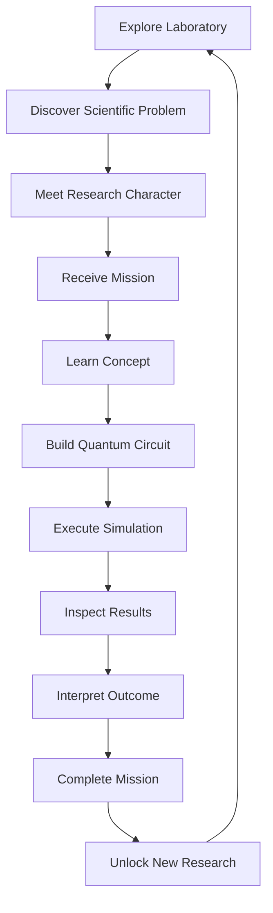

## 2.4 Product experience

The application combines several experiences:

| Experience | Purpose |
|---|---|
| Adventure | Introduces the fictional world |
| Laboratory | Provides interactive research environments |
| Simulator | Executes quantum circuits |
| Experiments | Teaches quantum concepts |
| Missions | Creates structured learning goals |
| Characters | Adds personality and storytelling |
| Tutor | Provides contextual explanations |
| Progression | Rewards scientific discovery |

## 2.5 Target audiences

Quantum Love Collider is designed for:

- Students exploring quantum computing.
- Curious beginners.
- STEM learners.
- Educators demonstrating quantum concepts.
- University students reviewing introductory material.
- People interested in interactive science games.
- Developers exploring quantum simulation.

The experience should support both casual exploration and increasingly advanced scientific investigation.

---

# 03 — THE PROBLEM

## 3.1 Quantum computing is difficult to visualize

Quantum computing introduces concepts that are unfamiliar to many learners.

Examples include:

- Complex probability amplitudes.
- Superposition.
- Relative phase.
- Interference.
- Entanglement.
- Quantum measurement.
- Unitary transformations.

These concepts are mathematically precise but can be difficult to understand through text alone.

## 3.2 Passive learning limitations

A static explanation of a Hadamard gate may describe its matrix, but it does not necessarily help a beginner understand how the gate changes a quantum state.

A circuit simulator helps bridge that gap.

The learner can apply the gate, inspect the resulting amplitudes, and measure the system.

## 3.3 Scientific concepts are interconnected

Understanding entanglement requires familiarity with multiple earlier concepts.

A learner needs some understanding of:

- Qubits.
- Basis states.
- Superposition.
- Controlled gates.
- Joint states.
- Measurement.

An isolated lesson may not provide enough context.

Quantum Love Collider addresses this through progressive missions and connected experiments.

## 3.4 Engagement challenges

Technical educational applications can become repetitive.

The project uses a story-driven laboratory environment to create additional motivation.

Instead of simply asking players to complete exercises, the game places scientific activities inside a fictional research mission.

## 3.5 The opportunity

Quantum computing education can benefit from an application that combines:

- Hands-on simulation.
- Scientific explanations.
- Guided experimentation.
- Visual feedback.
- Narrative progression.
- Reusable learning content.

Quantum Love Collider explores that opportunity.

---

# 04 — THE SOLUTION

## 4.1 Interactive quantum laboratory

The core solution is an accessible browser-based quantum laboratory.

Players can construct circuits, apply gates, execute simulations, and inspect their results.

## 4.2 Guided scientific experiments

Each experiment introduces a specific concept and provides a structured learning experience.

An experiment can include:

1. Introduction.
2. Learning objective.
3. Initial state.
4. Circuit.
5. Prediction.
6. Execution.
7. Measurement.
8. Explanation.
9. Completion.

## 4.3 Narrative learning

The fictional research facility creates context for scientific activities.

A character might ask the player to investigate a mysterious measurement distribution.

The player must use the simulator to determine what happened.

The story gives the activity a purpose.

## 4.4 A connected educational experience

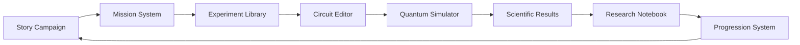

## 4.5 Core application areas

The main application experience is organized around:

- Home.
- Headquarters.
- Circuit Lab.
- Characters.
- Story.
- Experiments.
- Boss Challenges.
- Player Profile.

Each area contributes to the overall game experience.

---

# 05 — CORE GAMEPLAY

## 5.1 The laboratory

The player explores a research facility containing several specialized environments.

The original location concepts include:

| Location | Purpose |
|---|---|
| Quantum Collider | Main research facility |
| Cryogenic Basement | Experimental equipment challenges |
| Ex Archives | Historical records and clues |
| Particle Bar | Character interactions |
| Forbidden Laboratory | Advanced experiments |
| Multiverse Observatory | High-level research and anomalies |

Locations should become available through story progression.

## 5.2 Mission system

Missions provide structured objectives.

Examples:

- Meet a scientist.
- Visit a laboratory.
- Build a circuit.
- Apply a Hadamard gate.
- Produce a Bell state.
- Measure a quantum system.
- Interpret a probability distribution.
- Save an experiment.

## 5.3 Experiment workflow

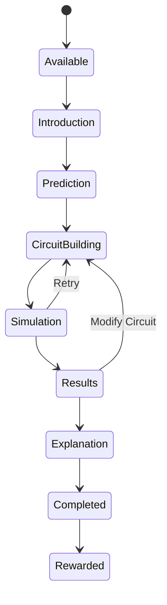

## 5.4 Player progression

The player progresses through research activities.

The progression system can track:

- Player level.
- Experience.
- Research points.
- Quantum shards.
- Missions.
- Achievements.
- Discoveries.
- Saved experiments.
- Unlocked locations.

## 5.5 Rewards

Rewards should be tied to meaningful scientific activity.

| Reward | Purpose |
|---|---|
| XP | Player level progression |
| Research Points | Scientific unlocks |
| Quantum Shards | Collectibles and cosmetics |
| Achievements | Recognition of milestones |

The reward system should prevent duplicate one-time rewards.

## 5.6 Challenge design

Challenges should evaluate actual player actions.

For example, a Bell-state challenge should validate the circuit and its resulting state rather than simply checking whether the player clicked a completion button.

---

# 06 — APPLICATION ARCHITECTURE

## 6.1 Architectural overview

The application follows a modular frontend architecture.

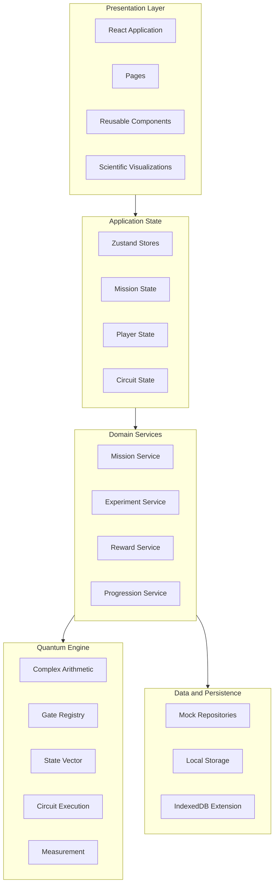

## 6.2 Presentation layer

The presentation layer contains the React interface.

Its responsibilities include:

- Rendering screens.
- Displaying player progress.
- Presenting scientific information.
- Handling player interactions.
- Showing simulator results.
- Providing navigation.

The presentation layer should not contain independent quantum calculations.

## 6.3 State management

Zustand provides centralized application state.

Separate stores or clearly separated slices should manage:

- Player profile.
- Circuit editor.
- Mission progress.
- Experiment progress.
- Story state.
- Settings.

Avoid duplicating the same information across multiple stores.

## 6.4 Domain services

Services handle application rules.

For example:

The Mission Service determines whether objectives are complete.

The Reward Service grants valid rewards.

The Experiment Service coordinates circuit execution and result recording.

The Progression Service calculates unlock conditions.

## 6.5 Quantum engine boundary

The quantum engine is isolated from the user interface.

It should accept validated circuit definitions and return calculated results.

This makes the simulator easier to test independently.

---

# 07 — QUANTUM COMPUTING FOUNDATIONS

## 7.1 What is a qubit?

A classical bit has two possible values:

\[
0,\quad 1
\]

A pure single-qubit quantum state can be represented as:

\[
|\psi\rangle=\alpha|0\rangle+\beta|1\rangle
\]

Where:

- \(\alpha\) is the complex amplitude associated with state zero.
- \(\beta\) is the complex amplitude associated with state one.

For a normalized state:

\[
|\alpha|^2+|\beta|^2=1
\]

## 7.2 Superposition

A Hadamard gate applied to the computational zero state produces:

\[
H|0\rangle=
\frac{|0\rangle+|1\rangle}{\sqrt{2}}
\]

The measurement probabilities are:

\[
P(0)=\frac{1}{2}
\]

\[
P(1)=\frac{1}{2}
\]

The game allows players to inspect the state and observe sampled measurement results.

## 7.3 Measurement

Measurement produces a classical outcome.

For a computational-basis measurement:

\[
P(0)=|\alpha|^2
\]

\[
P(1)=|\beta|^2
\]

A measurement sample is stochastic.

The observed counts from a finite number of shots may differ from the ideal theoretical probabilities.

## 7.4 Relative phase

A state can include relative phase:

\[
|\psi\rangle=
\frac{|0\rangle+e^{i\phi}|1\rangle}{\sqrt{2}}
\]

Relative phase affects interference.

It may not change the immediate computational-basis probabilities, but it can change later measurement outcomes after additional operations.

## 7.5 Entanglement

An example of a Bell state is:

\[
|\Phi^+\rangle=
\frac{|00\rangle+|11\rangle}{\sqrt{2}}
\]

This state cannot be represented as a product of two independent single-qubit pure states.

Measurement in the computational basis produces correlated results.

## 7.6 Scientific scope

Quantum Love Collider is an educational simulation.

It demonstrates mathematical quantum models and simplified experiments.

The browser simulator is not a physical quantum computer.

---

# 08 — QUANTUM SIMULATION ENGINE

## 8.1 Overview

The simulator is the scientific core of Quantum Love Collider.

The existing project foundation includes a state-vector simulation engine supporting up to eight qubits.

The engine uses complex amplitudes to represent quantum states.

## 8.2 State-vector representation

For \(n\) qubits, the state vector has:

\[
2^n
\]

complex amplitudes.

For three qubits:

\[
|\psi\rangle=
a_0|000\rangle+
a_1|001\rangle+
a_2|010\rangle+
a_3|011\rangle+
a_4|100\rangle+
a_5|101\rangle+
a_6|110\rangle+
a_7|111\rangle
\]

The normalization condition is:

\[
\sum_{i=0}^{2^n-1}|a_i|^2=1
\]

## 8.3 Simulator workflow

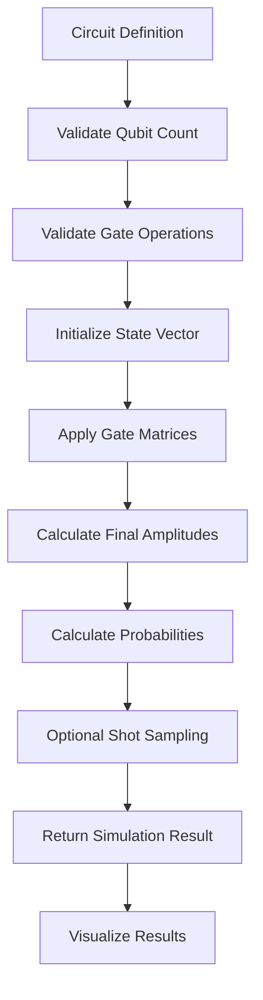

## 8.4 Complex arithmetic

The simulator requires complex-number operations.

A complex number is:

\[
z=a+bi
\]

Where:

- \(a\) is the real component.
- \(b\) is the imaginary component.

The arithmetic module should support:

- Addition.
- Subtraction.
- Multiplication.
- Magnitude.
- Squared magnitude.
- Complex conjugation.
- Normalization.
- Division where required.

## 8.5 Gate application

A quantum gate transforms a state through matrix multiplication.

For a single-qubit operation:

\[
|\psi'\rangle=U|\psi\rangle
\]

Where \(U\) is a unitary matrix.

For an \(n\)-qubit system, a single-qubit gate must be applied to the appropriate target-qubit subspace.

The implementation must preserve the simulator's qubit-index convention.

## 8.6 Qubit ordering

The existing engine uses qubit zero as the least-significant bit of the state-vector index.

Displayed bitstrings place the highest-index qubit on the left.

This convention must remain consistent across:

- Circuit diagrams.
- State vectors.
- Measurement outputs.
- Probability charts.
- Imported circuits.
- Tests.

## 8.7 Measurement

The simulator calculates ideal probabilities from the final state.

For computational-basis outcome \(i\):

\[
P(i)=|a_i|^2
\]

Sampling then generates observed counts from that distribution.

The application should clearly distinguish:

- Ideal probability.
- Observed count.
- Observed frequency.

## 8.8 Numerical stability

Scientific calculations should include:

- Normalization checks.
- Invalid-number checks.
- Probability bounds.
- Numerical tolerances.
- Deterministic test seeds.

Never compare complex floating-point values using strict equality when numerical approximation is involved.

---

# 09 — QUANTUM GATE SYSTEM

## 9.1 Gate registry

The gate registry provides a centralized definition of quantum operations.

The existing foundation includes:

- X.
- Y.
- Z.
- H.
- S.
- T.
- CNOT.
- CZ.

The gate system can be extended with rotation operations.

## 9.2 Pauli-X

\[
X=
\begin{bmatrix}
0&1\\
1&0
\end{bmatrix}
\]

The X gate exchanges computational basis states:

\[
X|0\rangle=|1\rangle
\]

\[
X|1\rangle=|0\rangle
\]

## 9.3 Pauli-Y

\[
Y=
\begin{bmatrix}
0&-i\\
i&0
\end{bmatrix}
\]

The Y gate combines a bit flip with phase factors.

## 9.4 Pauli-Z

\[
Z=
\begin{bmatrix}
1&0\\
0&-1
\end{bmatrix}
\]

The Z gate changes the phase of the |1⟩ component.

## 9.5 Hadamard

\[
H=
\frac{1}{\sqrt{2}}
\begin{bmatrix}
1&1\\
1&-1
\end{bmatrix}
\]

The Hadamard gate creates superposition from computational basis states.

## 9.6 Phase gates

The S gate:

\[
S=
\begin{bmatrix}
1&0\\
0&i
\end{bmatrix}
\]

The T gate:

\[
T=
\begin{bmatrix}
1&0\\
0&e^{i\pi/4}
\end{bmatrix}
\]

These operations demonstrate phase manipulation.

## 9.7 Controlled operations

CNOT applies an X operation to the target when the control is one.

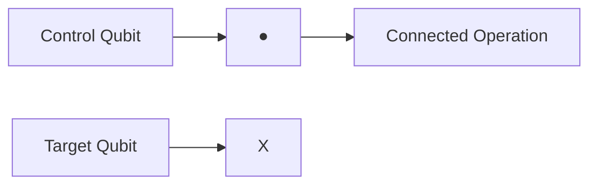

The control and target must be different qubits.

## 9.8 Rotation gates

Future advanced gate support includes:

\[
R_x(\theta)=
\begin{bmatrix}
\cos(\theta/2)&-i\sin(\theta/2)\\
-i\sin(\theta/2)&\cos(\theta/2)
\end{bmatrix}
\]

\[
R_y(\theta)=
\begin{bmatrix}
\cos(\theta/2)&-\sin(\theta/2)\\
\sin(\theta/2)&\cos(\theta/2)
\end{bmatrix}
\]

\[
R_z(\theta)=
\begin{bmatrix}
e^{-i\theta/2}&0\\
0&e^{i\theta/2}
\end{bmatrix}
\]

These operations enable more advanced circuit construction.

---

# 10 — CIRCUIT EDITOR

## 10.1 Overview

The Circuit Lab provides the primary hands-on interaction with the simulator.

Players can construct quantum circuits using a visual editor.

## 10.2 Circuit architecture

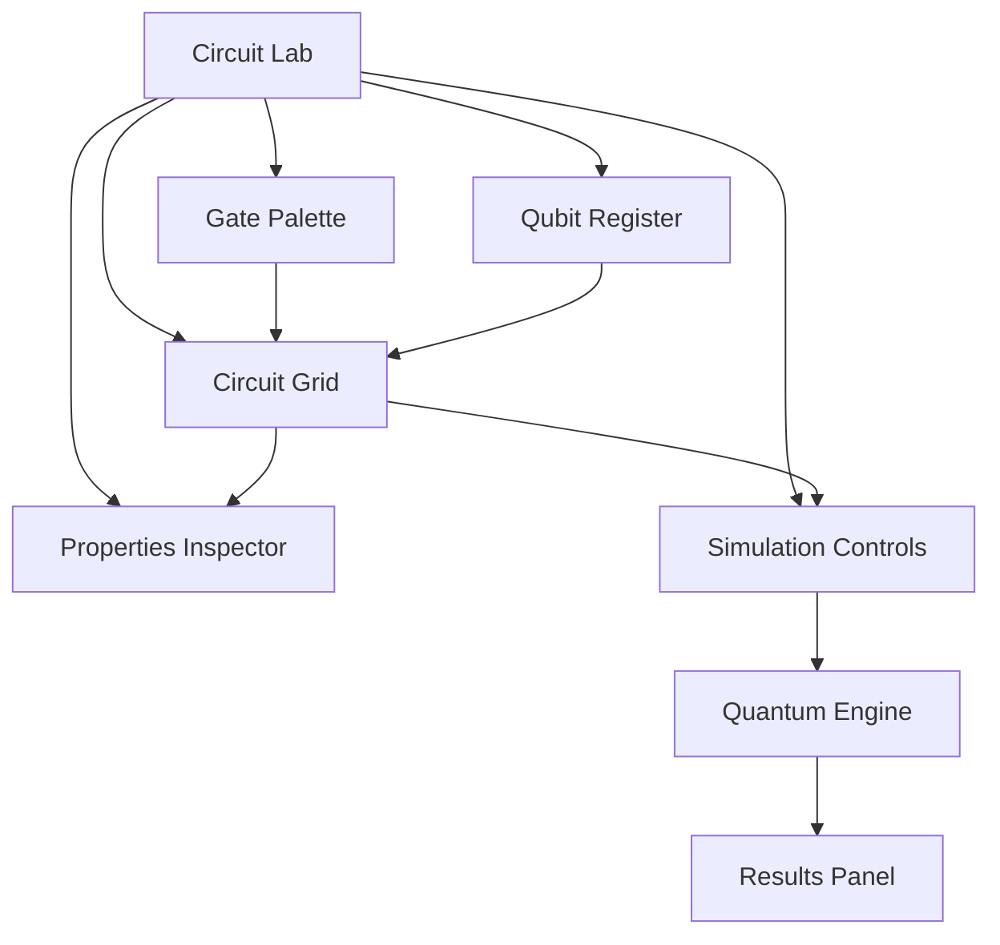

## 10.3 Gate palette

Organize gates into categories:

- Pauli.
- Hadamard.
- Phase.
- Rotation.
- Controlled operations.
- Measurement.

Each gate should have a scientific description.

## 10.4 Circuit operations

The editor should support:

- Adding qubits.
- Adding gates.
- Removing gates.
- Reordering gates.
- Editing parameters.
- Clearing circuits.
- Saving circuits.
- Loading templates.
- Duplicating circuits.

## 10.5 Circuit validation

Before execution, validate:

- Qubit count.
- Gate type.
- Target index.
- Control index.
- Gate parameters.
- Circuit schema.

Invalid circuits should produce understandable error messages.

## 10.6 Circuit templates

Example templates:

| Template | Concept |
|---|---|
| X Gate | Bit flip |
| Hadamard | Superposition |
| Phase Circuit | Relative phase |
| Bell State | Entanglement |
| Interference | Amplitude interference |
| Rotation Circuit | Continuous state transformations |

## 10.7 Circuit history

Support undo and redo.

Maintain a history of circuit-editing operations.

Keep history bounded to avoid unnecessary memory use.

## 10.8 Circuit export

Support JSON export containing:

- Schema version.
- Circuit ID.
- Name.
- Qubit count.
- Gate operations.
- Description.
- Difficulty.
- Tags.

## 10.9 Circuit import

Validate imported JSON before adding it to the active editor.

Never execute arbitrary imported code.

---

# 11 — QUANTUM EXPERIMENTS

## 11.1 Experiment library

The experiment library organizes scientific activities into structured learning modules.

An experiment should contain:

- ID.
- Title.
- Description.
- Concept.
- Difficulty.
- Learning objectives.
- Circuit template.
- Prediction question.
- Explanation.
- Reward.

## 11.2 Bell-state experiment

One of the central experiments is Bell-state preparation.

Initial state:

\[
|00\rangle
\]

Operations:

1. Apply H to q0.
2. Apply CNOT with q0 as control and q1 as target.

Result:

\[
|\Phi^+\rangle=
\frac{|00\rangle+|11\rangle}{\sqrt{2}}
\]

Expected ideal measurement distribution:

| State | Probability |
|---|---:|
| 00 | 50% |
| 01 | 0% |
| 10 | 0% |
| 11 | 50% |

The application should calculate this result through the simulator.

## 11.3 Superposition experiment

Players begin with:

\[
|0\rangle
\]

They apply H:

\[
H|0\rangle=
\frac{|0\rangle+|1\rangle}{\sqrt{2}}
\]

The experiment allows players to inspect amplitudes and sample measurement outcomes.

## 11.4 Interference experiment

Players investigate the role of relative phase.

They compare circuits that produce different interference outcomes.

The interface should display intermediate states and final probabilities.

## 11.5 Measurement experiment

Players investigate how repeated measurements produce a statistical distribution.

Allow configurable shot counts.

Compare observed frequencies with theoretical probabilities.

## 11.6 Research notebook

Each experiment can be saved with:

- Hypothesis.
- Prediction.
- Circuit.
- Result.
- Measurement counts.
- Interpretation.
- Notes.

## 11.7 Experiment architecture

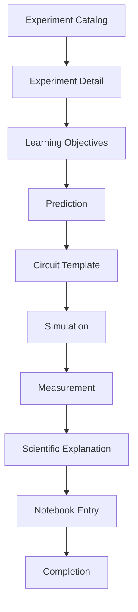

---

# 12 — ADVANCED QUANTUM ALGORITHMS

The advanced roadmap expands the simulator into a broader educational research environment.

These capabilities should be implemented as extensions to the same quantum engine.

They should not become separate decorative simulations.

## 12.1 Deutsch algorithm

Introduce the problem of determining whether a one-bit Boolean function is constant or balanced under the algorithm's promise.

The player should build and execute a valid oracle circuit.

## 12.2 Deutsch–Jozsa algorithm

Expand the oracle problem to multiple input bits.

Display the final measurement distribution and explain the promise problem.

## 12.3 Grover search

Grover's algorithm demonstrates amplitude amplification for unstructured search.

The educational implementation should support small systems.

The experiment should include:

1. Initial uniform superposition.
2. Oracle.
3. Diffusion operator.
4. Repeated iterations.
5. Measurement.

## 12.4 Quantum teleportation

The teleportation lesson introduces:

- An unknown input state.
- Shared entanglement.
- Bell-basis operations.
- Classical measurement results.
- Conditional corrections.

The application should explain that quantum teleportation transfers a quantum state using entanglement and classical communication.

It does not teleport physical matter.

## 12.5 Quantum Fourier Transform

The QFT lesson introduces controlled phase operations and the mathematical relationship between computational basis states and Fourier basis states.

## 12.6 Phase estimation

Introduce eigenstates, eigenvalues, controlled operations, inverse QFT, and phase approximation.

## 12.7 Variational circuits

Introduce parameterized quantum circuits and classical optimization.

A simple educational implementation can show how changing rotation parameters affects a defined objective.

## 12.8 Quantum error correction

Future modules should introduce:

- Bit-flip errors.
- Phase-flip errors.
- Syndrome measurement.
- Three-qubit repetition code.
- Logical states.
- Noise models.

The simulator should distinguish ideal operations from simplified noise models.

## 12.9 Density matrices

An advanced mathematical extension should support:

\[
\rho=|\psi\rangle\langle\psi|
\]

Density matrices enable demonstrations of mixed states and reduced quantum states.

## 12.10 Scientific limitations

These algorithm demonstrations are educational implementations.

They do not establish a general practical quantum advantage.

The application should clearly communicate the assumptions and limitations of each experiment.

---

# 13 — GAME MECHANICS AND PROGRESSION

## 13.1 Player profile

The player profile stores:

- Display name.
- Level.
- XP.
- Research points.
- Quantum shards.
- Achievements.
- Completed missions.
- Saved circuits.
- Experiment history.

## 13.2 Mission engine

Missions use structured objectives.

Possible objective types include:

- Visit location.
- Complete dialogue.
- Build circuit.
- Execute experiment.
- Make prediction.
- Answer quiz.
- Save research note.

## 13.3 Achievement system

Example achievements:

| Achievement | Condition |
|---|---|
| First Experiment | Complete first experiment |
| Superposition Explorer | Complete superposition activity |
| Phase Detective | Complete phase experiment |
| Entanglement Apprentice | Prepare Bell state |
| Circuit Architect | Save multiple circuits |
| Research Archivist | Save research notes |
| Algorithm Engineer | Complete an algorithm challenge |

## 13.4 Research progression

Advanced research should unlock based on meaningful prerequisites.

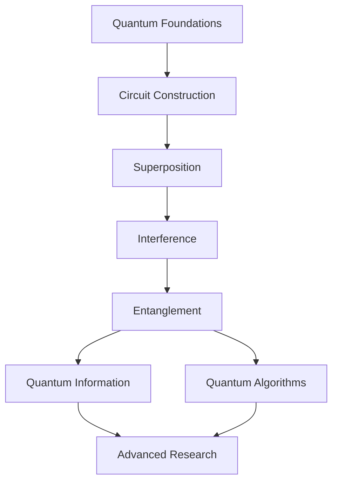

## 13.5 Boss encounters

Boss encounters turn scientific problems into structured challenges.

Potential boss themes:

- Decoherence.
- Probability interpretation.
- Entanglement.
- Circuit debugging.
- Quantum algorithms.

A boss challenge should evaluate actual circuit behavior and scientific understanding.

---

# 14 — CHARACTERS AND STORY CAMPAIGN

## 14.1 The research team

The existing project character roster includes:

| Character | Role |
|---|---|
| Dr. Evelyn Schrödinger | Research scientist |
| Maya Chen | Experimental researcher |
| Leo Park | Engineering specialist |
| B.R.A.D. | Laboratory companion |
| Dr. Victor Null | Antagonistic research figure |

Preserve the original character identities and established story material.

## 14.2 Story concept

A catastrophic collider experiment has destabilized the research facility.

The team must investigate anomalies, reconstruct experiments, and uncover the events behind the failure.

The story introduces scientific challenges naturally.

## 14.3 Character interactions

Characters can provide:

- Mission briefings.
- Scientific hints.
- Experiment reactions.
- Story clues.
- Optional dialogue.
- Character development.

## 14.4 Dialogue architecture

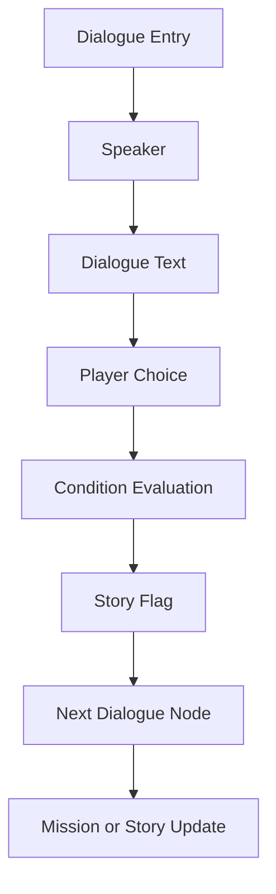

## 14.5 Narrative progression

Track important story flags.

Examples:

- Character introductions completed.
- Research archive discovered.
- Experimental anomaly investigated.
- Forbidden laboratory unlocked.
- Advanced mission completed.

## 14.6 Research mystery

The research mystery system can connect evidence from multiple locations.

Evidence may originate from:

- Character dialogue.
- Experiment results.
- Archived reports.
- Laboratory events.
- Scientific discoveries.

The player should be able to review and connect evidence.

---

# 15 — AI QUANTUM TUTOR

## 15.1 Overview

The AI Quantum Tutor is designed to provide contextual educational explanations.

The default demo experience should operate without an external AI API.

It can use a structured local explanation library.

## 15.2 Tutor modes

| Mode | Behavior |
|---|---|
| Professor | Detailed scientific explanation |
| Lab Partner | Conversational guidance |
| Debugger | Circuit error diagnosis |
| Exam Coach | Guided questions and hints |

## 15.3 Context-aware explanations

The tutor can use structured context such as:

- Current experiment.
- Circuit definition.
- Simulator result.
- Player difficulty.
- Previous quiz answer.
- Mission objective.

## 15.4 Socratic learning

Rather than immediately revealing answers, the tutor can ask questions.

Example:

"Which component of the state changes sign when you apply the Z gate?"

The player can request additional hints or a direct explanation.

## 15.5 Tutor architecture

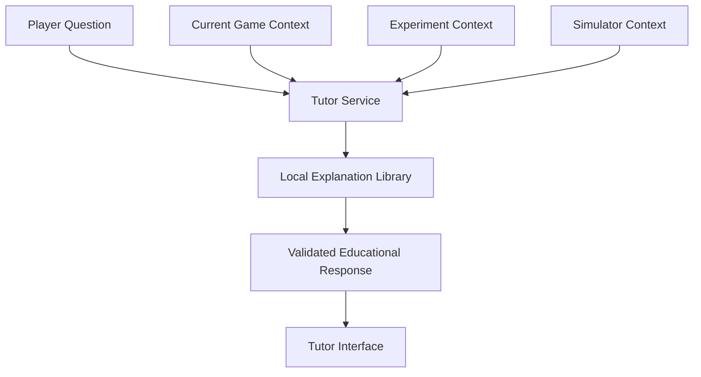

## 15.6 Scientific reliability

The simulator remains authoritative for calculated results.

The tutor should explain simulator outputs, not replace them.

If an external model is added later, keep it behind a server-side service and avoid exposing private credentials in the frontend.

---

# 16 — DATA ARCHITECTURE AND MOCK DATA

## 16.1 Data philosophy

Quantum Love Collider uses structured data definitions for its fictional world and educational content.

Mock data allows the full application to function without an external backend.

Mock data should be clearly separated from actual calculated scientific results.

## 16.2 Core data entities

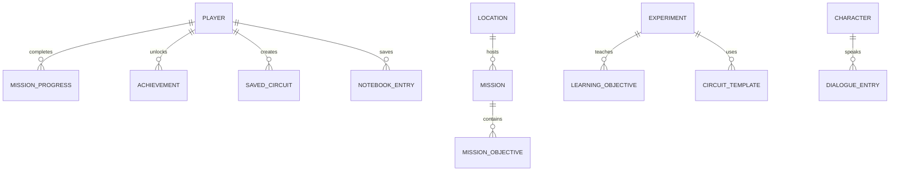

## 16.3 Mission data

A mission should include:

- Unique ID.
- Title.
- Description.
- Location.
- Difficulty.
- Prerequisites.
- Objectives.
- Rewards.
- Estimated duration.

## 16.4 Experiment data

An experiment should include:

- Unique ID.
- Scientific concept.
- Difficulty.
- Circuit template.
- Prediction question.
- Explanation.
- Learning objectives.
- Completion conditions.

## 16.5 Character data

A character record should include:

- ID.
- Name.
- Role.
- Biography.
- Personality.
- Specialty.
- Portrait reference.
- Dialogue references.

## 16.6 Example TypeScript model

```ts
export interface ExperimentDefinition {
  id: string;
  title: string;
  description: string;
  concept: string;
  difficulty: "beginner" | "intermediate" | "advanced";
  qubits: number;
  circuitTemplateId: string;
  learningObjectives: string[];
  predictionQuestion: string;
  explanation: string;
  estimatedMinutes: number;
  tags: string[];
}
```

## 16.7 Mock data expansion

Potential content targets for the completed expansion:

| Dataset | Target |
|---|---:|
| Characters | 5+ |
| Story chapters | 18+ |
| Experiments | 90+ |
| Missions | 60+ |
| Achievements | 60+ |
| Dialogue entries | 300+ |
| Quiz questions | 120+ |
| Glossary entries | 40+ |
| Research documents | 30+ |
| Circuit templates | 40+ |
| Boss challenges | 12+ |

These are expansion targets rather than claims about the initial ZIP.

---

# 17 — PERSISTENCE AND STORAGE

## 17.1 Local-first architecture

The application should remain playable without requiring an account or backend.

Player progress should persist locally.

## 17.2 Stored information

Potential saved information includes:

- Player profile.
- Game settings.
- Mission progress.
- Story flags.
- Achievements.
- Saved circuits.
- Experiment history.
- Research notebook.
- Discovered collectibles.

## 17.3 Storage architecture

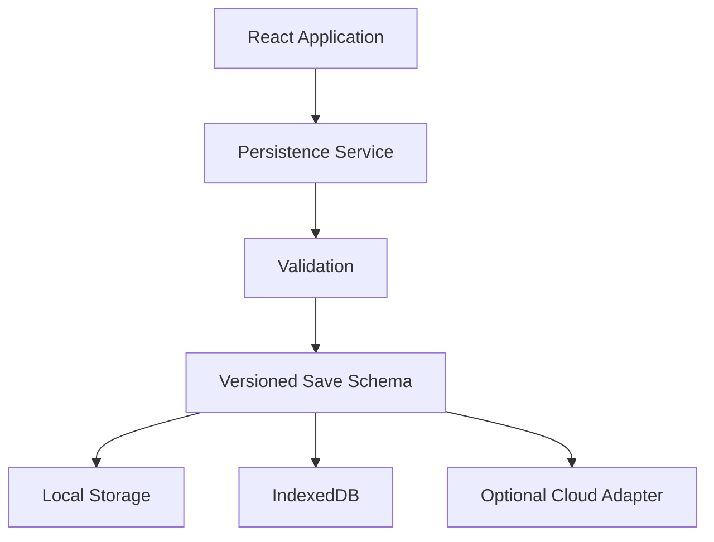

## 17.4 Versioned save data

Use a schema version.

When the data model changes:

1. Load saved data.
2. Validate its structure.
3. Identify its version.
4. Apply migrations.
5. Save the migrated version.
6. Recover gracefully if migration fails.

## 17.5 Export and restore

Provide a way to export player data as JSON.

Before restoring a backup:

- Validate the file.
- Display a preview.
- Check schema compatibility.
- Ask for confirmation.
- Preserve an existing backup where appropriate.

## 17.6 Future backend architecture

Optional future services could include:

- Supabase authentication.
- Cloud save synchronization.
- Teacher accounts.
- Classroom management.
- Shared lessons.

These should remain optional.

The local demo experience should not depend on them.

---

# 18 — TESTING, SECURITY AND PERFORMANCE

## 18.1 Testing strategy

The scientific engine requires independent verification.

Use Vitest for unit tests.

Test important domain services and state transitions.

## 18.2 Quantum engine tests

Important tests include:

- Complex arithmetic.
- State normalization.
- X gate.
- Y gate.
- Z gate.
- H gate.
- S gate.
- T gate.
- CNOT.
- CZ.
- Rotation gates.
- Measurement.
- Bell-state preparation.
- Invalid circuit handling.

## 18.3 Scientific invariants

For a normalized quantum state:

\[
\sum_i |a_i|^2=1
\]

For ideal unitary operations:

\[
U^\dagger U=I
\]

Measurement probabilities must satisfy:

\[
\sum_i P(i)=1
\]

Tests should use numerical tolerances.

## 18.4 Application tests

Test:

- Mission completion.
- Reward uniqueness.
- Player progression.
- Circuit editing.
- Circuit import.
- Circuit export.
- Save data.
- Migration.
- Story progression.
- Experiment history.

## 18.5 End-to-end player journey

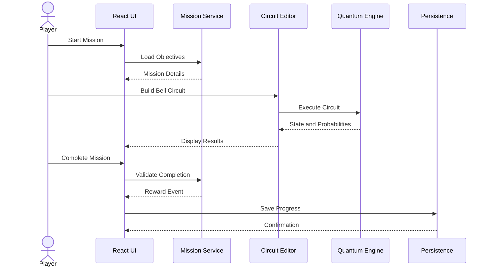

## 18.6 Security

Important safeguards:

- Validate imported JSON.
- Sanitize user-generated text.
- Avoid unsafe HTML injection.
- Do not expose private API credentials.
- Validate storage data.
- Keep optional backend access controlled.
- Never execute imported code.

## 18.7 Performance

The initial state-vector simulator supports a limited number of qubits.

For \(n\) qubits, the state vector contains \(2^n\) amplitudes.

This creates exponential memory growth.

The browser implementation should maintain conservative limits and avoid increasing them without testing.

## 18.8 Accessibility

Support:

- Keyboard navigation.
- Screen-reader labels.
- Visible focus states.
- Color contrast.
- Reduced motion.
- Responsive layouts.
- Text explanations for visual results.

---

# 19 — INSTALLATION AND DEVELOPMENT

## 19.1 Requirements

Recommended development environment:

- Node.js.
- npm.
- Modern browser.
- Git.
- Code editor.

## 19.2 Installation

Clone the repository:

```bash
git clone https://github.com/YOUR_USERNAME/quantum-love-collider.git
```

Enter the project directory:

```bash
cd quantum-love-collider
```

Install dependencies:

```bash
npm install
```

Start the development server:

```bash
npm run dev
```

## 19.3 Production build

```bash
npm run build
```

## 19.4 Testing

```bash
npm run test
```

If the repository provides a separate test or type-check script, use the scripts defined in its package configuration.

## 19.5 Project organization

A recommended logical organization is:

```text
src/
│
├── components/
│   ├── circuit/
│   ├── laboratory/
│   ├── characters/
│   ├── experiments/
│   ├── missions/
│   ├── charts/
│   └── shared/
│
├── pages/
│   ├── Home/
│   ├── Headquarters/
│   ├── CircuitLab/
│   ├── Experiments/
│   ├── Characters/
│   ├── Story/
│   ├── Boss/
│   └── Profile/
│
├── quantum/
│   ├── complex/
│   ├── gates/
│   ├── simulator/
│   ├── measurement/
│   └── validation/
│
├── services/
│   ├── missions/
│   ├── experiments/
│   ├── progression/
│   ├── rewards/
│   └── tutor/
│
├── data/
│   ├── characters/
│   ├── missions/
│   ├── experiments/
│   ├── dialogue/
│   └── achievements/
│
├── stores/
│
├── schemas/
│
├── persistence/
│
├── hooks/
│
├── types/
│
└── tests/
```

This is a logical architectural guide. Keep existing working file locations if the imported repository uses a different organization.

## 19.6 Development workflow

Recommended development sequence:

1. Audit the existing code.
2. Identify the affected subsystem.
3. Implement one feature.
4. Run tests.
5. Run type checking.
6. Run the production build.
7. Review the UI.
8. Test the player journey.
9. Commit the changes.

## 19.7 Lovable development

The project can be developed further in Lovable.

Recommended workflow:

- Import the existing ZIP.
- Preserve the existing project structure.
- Use phased implementation prompts.
- Review changed files.
- Verify simulator correctness.
- Test all new interactions.
- Build after each milestone.

---

# 20 — ROADMAP AND FUTURE RESEARCH

## 20.1 Current core foundation

The original project foundation includes:

- React and TypeScript application.
- Vite build system.
- Zustand state management.
- Framer Motion.
- Quantum state-vector simulator.
- Complex-number arithmetic.
- Gate registry.
- Eight-gate foundation.
- Circuit editor.
- Experiment interface.
- Story and character systems.
- Mission and achievement data.
- Local demo persistence.

The exact completion status of individual features should be verified against the current repository.

## 20.2 Expansion I — Advanced learning

Planned development:

- Rotation gates.
- Advanced experiment catalog.
- Research notebook.
- Circuit import and export.
- Improved probability visualization.
- More comprehensive testing.
- Advanced progression.

## 20.3 Expansion II — Quantum algorithms

Planned development:

- Deutsch algorithm.
- Deutsch–Jozsa algorithm.
- Grover search.
- Quantum teleportation.
- Quantum Fourier Transform.
- Phase estimation.
- Variational circuits.

## 20.4 Expansion III — Quantum information

Planned development:

- Density matrices.
- Pure and mixed states.
- Partial trace.
- Entanglement measures.
- Bell inequality experiments.
- Quantum state tomography.

## 20.5 Expansion IV — Error correction

Planned development:

- Bit-flip code.
- Phase-flip code.
- Syndrome measurement.
- Noise models.
- Error recovery.
- Hardware constraint demonstrations.

## 20.6 Expansion V — Advanced gameplay

Planned development:

- Season two story campaign.
- Advanced boss encounters.
- Procedural challenge generation.
- Research specialization.
- Character story arcs.
- Player-created experiments.
- Research portfolio.

## 20.7 Expansion VI — Education platform

Planned development:

- Classroom mode.
- Teacher dashboard.
- Lesson authoring.
- Assignment creation.
- Learning reports.
- Printable educational material.

## 20.8 Expansion VII — Platform capabilities

Potential future features:

- PWA installation.
- Optional cloud saves.
- Cross-device synchronization.
- Additional scientific visualization.
- Advanced accessibility.
- Expanded testing infrastructure.

## 20.9 Long-term vision

The long-term vision is to create a comprehensive interactive quantum learning environment.

A player should be able to move from their first experience with a qubit to constructing and investigating increasingly advanced quantum circuits.

The application should support both narrative-driven learning and independent scientific experimentation.

---

# APPENDIX A — SCIENTIFIC REFERENCE EQUATIONS

## A.1 Qubit normalization

\[
|\alpha|^2+|\beta|^2=1
\]

## A.2 Born rule

\[
P(i)=|\langle i|\psi\rangle|^2
\]

## A.3 Unitary transformation

\[
|\psi'\rangle=U|\psi\rangle
\]

## A.4 Unitarity

\[
U^\dagger U=I
\]

## A.5 Bell state

\[
|\Phi^+\rangle=
\frac{|00\rangle+|11\rangle}{\sqrt{2}}
\]

## A.6 Density matrix

\[
\rho=|\psi\rangle\langle\psi|
\]

## A.7 State fidelity for pure states

\[
F=|\langle\psi|\phi\rangle|^2
\]

These equations are intended as introductory reference material. Individual experiments should explain the assumptions and mathematical context behind their use.

---

# APPENDIX B — PRODUCT ACCEPTANCE CRITERIA

The project should be considered ready for a release candidate only after the following criteria have been verified.

## Application

- [ ] Application starts successfully.
- [ ] Navigation works.
- [ ] Existing screens remain accessible.
- [ ] Responsive layout works.
- [ ] Error states are handled.
- [ ] No major buttons are inert.

## Quantum engine

- [ ] State initialization works.
- [ ] Gate application works.
- [ ] Gate validation works.
- [ ] Measurement probabilities normalize.
- [ ] Shot sampling works.
- [ ] Bell-state example is verified.
- [ ] Numerical tolerances are tested.

## Circuit editor

- [ ] Gates can be placed.
- [ ] Gates can be removed.
- [ ] Parameters can be edited where supported.
- [ ] Invalid circuits are rejected.
- [ ] Circuits can be saved.
- [ ] Circuits can be loaded.

## Gameplay

- [ ] Missions work.
- [ ] Rewards are validated.
- [ ] Progress persists.
- [ ] Experiments can be completed.
- [ ] Achievements unlock correctly.
- [ ] Story progression works.

## Education

- [ ] Explanations are scientifically accurate.
- [ ] Simulator results are not fabricated.
- [ ] Mock data is identified.
- [ ] Advanced concepts include prerequisites.
- [ ] Accessibility is considered.

## Engineering

- [ ] TypeScript checks pass.
- [ ] Automated tests pass.
- [ ] Production build succeeds.
- [ ] Imported data is validated.
- [ ] Save migrations are tested.
- [ ] No private credentials are exposed.

---

# APPENDIX C — CONTRIBUTING

Contributions should prioritize scientific correctness, maintainability, accessibility, and meaningful educational value.

## Suggested contribution areas

- Quantum gate implementation.
- Simulator testing.
- Circuit editor improvements.
- Scientific visualizations.
- Experiment content.
- Story and dialogue.
- Accessibility.
- Performance.
- Educational documentation.

## Contribution guidelines

1. Inspect the existing architecture.
2. Avoid duplicating existing functionality.
3. Keep scientific calculations separate from presentation.
4. Add tests for new mathematical behavior.
5. Document assumptions.
6. Preserve existing data formats when possible.
7. Avoid unsupported scientific claims.
8. Verify the production build.

---

# APPENDIX D — PROJECT PHILOSOPHY

Quantum Love Collider is built around a simple idea:

**Quantum physics should be something people can explore, experiment with, and understand—not just something they read about.**

The collider is fictional.

The characters are fictional.

The laboratory mysteries are fictional.

But the mathematics behind the quantum experiments should be real.

Through a combination of interactive circuits, scientific visualization, storytelling, and structured experimentation, Quantum Love Collider aims to make quantum computing more approachable and engaging.

---

<p align="center">

# 💗 BUILD. EXPERIMENT. DISCOVER.

**Welcome to Quantum Love Collider.**

*Where quantum mechanics meets laboratory chaos.*

</p>

